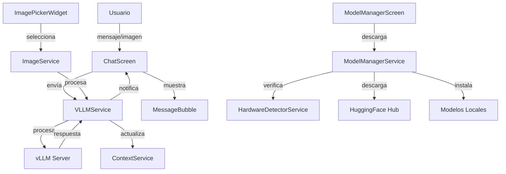

# LightChat - Plan de Transformación vLLM
**Fecha: 14 de febrero de 2026**

---

## 🎯 Resumen de Cambios

El proyecto LightChat sufrirá una transformación completa para convertirse en un **chat ligero general** con las siguientes características principales:

1. **Backend único**: vLLM (eliminación de Ollama y LM Studio)
2. **Gestión integrada de modelos**: Descarga y administración sin salir de la app
3. **Enfoque general**: Eliminación completa del soporte de programación
4. **Multimodal**: Soporte para enviar y recibir imágenes
5. **UI estilo mensajería**: Aspecto similar a WhatsApp pero diferenciado

---

## 📋 Análisis de Cambios por Componente

### 🔴 Componentes a ELIMINAR

| Archivo/Componente | Motivo |
|-------------------|--------|
| `lib/screens/ide_screen.dart` | IDE completo eliminado |
| `lib/services/ide_agent_service.dart` | Agente IDE eliminado |
| `lib/services/ide_agent_state.dart` | Estado del agente eliminado |
| `lib/services/code_analysis_service.dart` | Análisis de código eliminado |
| `lib/services/code_analysis_service_new.dart` | Análisis de código eliminado |
| `lib/widgets/file_upload_widget.dart` | Carga de archivos de código eliminada |
| `lib/widgets/code_display_widget.dart` | Visualizador de código eliminado |
| `lib/widgets/chat_mode_selector.dart` | Selector de modo eliminado |
| `lib/models/code_file.dart` | Modelo de archivo de código eliminado |
| `lib/widgets/backend_selector.dart` | Selector de backend eliminado |
| `lib/config/ollama_config.dart` | Configuración Ollama eliminada |

### 🟡 Componentes a MODIFICAR

| Archivo | Cambios Necesarios |
|---------|-------------------|
| `lib/main.dart` | Eliminar providers de IDE y programación |
| `lib/services/chat_service.dart` | Reescritura completa para vLLM |
| `lib/screens/chat_screen.dart` | Rediseño UI estilo mensajería |
| `lib/widgets/message_bubble.dart` | Soporte para imágenes, estilo WhatsApp |
| `lib/widgets/advanced_settings.dart` | Nuevo panel de gestión de modelos |
| `lib/widgets/model_selector.dart` | Integración con descarga de modelos |
| `lib/services/context_service.dart` | Simplificar (solo chat general) |

### 🟢 Componentes NUEVOS a CREAR

| Archivo | Descripción |
|---------|-------------|
| `lib/services/vllm_service.dart` | Servicio principal de vLLM |
| `lib/services/model_manager_service.dart` | Gestión de modelos locales |
| `lib/services/model_catalog_service.dart` | **Catálogo online dinámico** |
| `lib/services/hardware_detector_service.dart` | Detección de hardware disponible |
| `lib/services/image_service.dart` | Manejo de imágenes multimodal |
| `lib/models/local_model.dart` | Modelo de modelo local |
| `lib/models/chat_message.dart` | Nuevo modelo con soporte de imágenes |
| `lib/screens/model_manager_screen.dart` | Pantalla de gestión de modelos |
| `lib/screens/model_download_screen.dart` | Pantalla de descarga de modelos |
| `lib/widgets/image_picker_widget.dart` | Selector de imágenes |
| `lib/widgets/image_message_bubble.dart` | Burbuja para imágenes |
| `lib/widgets/model_capability_icons.dart` | Iconos de capacidades del modelo |
| `lib/widgets/chat_input_new.dart` | Campo de entrada con soporte multimedia |
| `lib/widgets/model_download_card.dart` | Tarjeta de descarga de modelo |
| `lib/config/vllm_config.dart` | Configuración de vLLM |
| `lib/utils/hardware_utils.dart` | Utilidades de hardware |

---

## 🔧 Características Detalladas a Implementar

### 1. Servicio vLLM Integrado

```
┌─────────────────────────────────────────────────────────────┐
│                    VLLMService                               │
├─────────────────────────────────────────────────────────────┤
│ - Conexión directa con vLLM server                          │
│ - API compatible con OpenAI                                  │
│ - Soporte multimodal (texto + imágenes)                     │
│ - Streaming de respuestas                                   │
│ - Gestión de contexto optimizada                            │
└─────────────────────────────────────────────────────────────┘
```

**Funcionalidades:**
- Iniciar/detener servidor vLLM desde la app
- Configurar parámetros del servidor
- Monitorizar estado del servidor
- API endpoints:
  - `POST /v1/chat/completions` - Chat con soporte multimodal
  - `GET /v1/models` - Listar modelos disponibles
  - `POST /v1/models/load` - Cargar modelo específico

### 2. Gestión de Modelos Locales

```
┌─────────────────────────────────────────────────────────────┐
│                  ModelManagerService                         │
├─────────────────────────────────────────────────────────────┤
│ - Descarga de modelos desde HuggingFace                     │
│ - Detección de hardware para recomendaciones                │
│ - Progreso de descarga en tiempo real                       │
│ - Gestión de espacio en disco                               │
│ - Versionado de modelos                                     │
└─────────────────────────────────────────────────────────────┘
```

**Modelos Recomendados por Hardware (Chat General - Preferencia Uncensored):**

| Hardware | Modelos Recomendados | VRAM/RAM | Notas |
|----------|---------------------|----------|-------|
| GPU RTX 3060 (12GB) | **Dolphin-2.9-Llama3-8B**, Mistral-7B-OpenHermes | 8-10GB | Uncensored preferidos |
| GPU RTX 4070 (12GB) | **Dolphin-2.9-Llama3-8B**, **Nous-Hermes-2-Mixtral-8x7B**, Mistral-7B-OpenHermes | 8-12GB | Mixtral cuantizado |
| GPU RTX 4080 (16GB) | **Nous-Hermes-2-Mixtral-8x7B**, **Dolphin-2.9-Llama3-8B**, WizardLM-2-8x22B-Quantized | 12-16GB | Modelos grandes uncensored |
| GPU RTX 4090 (24GB) | **WizardLM-2-8x22B**, **Nous-Hermes-2-Mixtral-8x7B**, Dolphin-2.9-Llama3-70B | 20-24GB | Máxima calidad uncensored |
| CPU Only (16GB RAM) | **TinyLlama-1.1B-Chat**, Phi-3-mini, **Dolphin-2.6-Phi-2** | 4-8GB | Modelos ligeros |
| CPU Only (32GB RAM) | **Dolphin-2.9-Llama3-8B-Q4**, **Mistral-7B-OpenHermes-Q4** | 8-16GB | Cuantizados 4-bit |

**Características de Modelos (Chat General - Uncensored Primero):**

| Modelo | Texto | Imágenes | Contexto | Censura | Licencia |
|--------|-------|----------|----------|---------|----------|
| **Dolphin-2.9-Llama3-8B** | ✅ | ❌ | 128K | ❌ Sin censura | Apache 2.0 |
| **Mistral-7B-OpenHermes** | ✅ | ❌ | 32K | ❌ Sin censura | Apache 2.0 |
| **Nous-Hermes-2-Mixtral-8x7B** | ✅ | ❌ | 32K | ❌ Sin censura | Apache 2.0 |
| **WizardLM-2-8x22B** | ✅ | ❌ | 64K | ❌ Sin censura | Apache 2.0 |
| **Dolphin-2.6-Phi-2** | ✅ | ❌ | 2K | ❌ Sin censura | MIT |
| **TinyLlama-1.1B-Chat** | ✅ | ❌ | 2K | ⚠️ Parcial | Apache 2.0 |
| Llama-3.2-11B-Vision | ✅ | ✅ | 128K | ⚠️ Censurado | Meta |
| Pixtral-12B | ✅ | ✅ | 128K | ⚠️ Parcial | Apache 2.0 |
| Qwen2-VL-7B | ✅ | ✅ | 32K | ⚠️ Censurado | Apache 2.0 |
| Phi-3.5-Vision | ✅ | ✅ | 128K | ⚠️ Censurado | MIT |

**Leyenda de Censura:**
- ❌ **Sin censura**: Modelo completamente libre, responde a cualquier consulta
- ⚠️ **Parcial**: Algunas restricciones menores
- ⚠️ **Censurado**: Restricciones significativas de contenido

**Nota:** Los modelos en **negrita** son los recomendados prioritarios por ser uncensored.

---

### 2.5 Catálogo de Modelos Online (Dinámico - NO Hardcodeado)

**IMPORTANTE: Los modelos disponibles NO están hardcodeados. Se consultan online cada vez que se abre la aplicación para detectar nuevos modelos y actualizaciones.**

```
┌─────────────────────────────────────────────────────────────┐
│                  ModelCatalogService                         │
├─────────────────────────────────────────────────────────────┤
│ - Consulta periódica a APIs de HuggingFace                  │
│ - Filtrado por tipo de modelo (chat, uncensored, multimodal)│
│ - Verificación de compatibilidad con hardware               │
│ - Caché local para modo offline                             │
│ - Notificación de nuevos modelos disponibles                │
└─────────────────────────────────────────────────────────────┘
```

**Fuentes de Modelos:**

| Fuente | API | Tipo de Modelos |
|--------|-----|-----------------|
| HuggingFace Hub | huggingface.co/api | Todos los modelos open-source |
| OpenRouter | openrouter.ai/api | Modelos comerciales y open-source |
| Modelos Locales | File system | Modelos descargados previamente |

**Criterios de Filtrado:**

1. **Preferencia Uncensored**: Priorizar modelos sin censura
2. **Compatibilidad Hardware**: Solo mostrar modelos que funcionen en el hardware detectado
3. **Tamaño**: Filtrar por espacio disponible en disco
4. **Tipo**: Texto-only vs Multimodal según necesidades del usuario
5. **Popularidad**: Ordenar por descargas y valoraciones

**Flujo de Actualización:**

```
Inicio de App
    |
    v
Verificar conexión a internet
    |
    +-- Sin conexión --> Usar caché local
    |
    v
Con conexión --> Consultar APIs
    |
    v
Comparar con modelos instalados
    |
    v
Mostrar novedades y actualizaciones
    |
    v
Ofrecer descarga de nuevos modelos
```

### 3. Interfaz de Usuario Estilo Mensajería

```
┌─────────────────────────────────────────────────────────────┐
│  ┌─────┐  LightChat                        [Modelo: ▼] [⚙️] │
│  └─────┘                                                     │
├─────────────────────────────────────────────────────────────┤
│                                                              │
│  ┌──────────────────────────────────────────────────────┐   │
│  │ 🖼️ [Imagen recibida]                                 │   │
│  │ Hola, ¿puedes describir esta imagen?                 │   │
│  └──────────────────────────────────────────────────────┘   │
│                                              14:32          │
│                                                              │
│         ┌──────────────────────────────────────────────┐    │
│         │ Claro, en la imagen puedo ver...              │    │
│         │ [Respuesta del modelo]                        │    │
│         └──────────────────────────────────────────────┘    │
│         14:32  ✨ vLLM • Llama-3.2-Vision                  │
│                                                              │
│  ┌──────────────────────────────────────────────────────┐   │
│  │ 🖼️ [Imagen enviada]                                  │   │
│  │ ¿Qué animales ves aquí?                              │   │
│  └──────────────────────────────────────────────────────┘   │
│                                              14:35          │
│                                                              │
├─────────────────────────────────────────────────────────────┤
│  [📎] [Escribe un mensaje...                    ] [🎤] [➤] │
└─────────────────────────────────────────────────────────────┘
```

**Elementos de UI:**

1. **Header compacto**
   - Logo/Nombre de la app
   - Selector de modelo con indicador de capacidades
   - Botón de configuración

2. **Burbujas de mensaje**
   - Diseño moderno similar a apps de mensajería
   - Soporte para imágenes integradas
   - Timestamp y modelo utilizado
   - Indicador de capacidades usadas (texto, imagen)

3. **Campo de entrada**
   - Botón de adjuntar (imágenes)
   - Campo de texto expandible
   - Botón de enviar
   - Indicador de modelo activo

4. **Indicadores de capacidad del modelo**
   ```
   [📝] Solo texto
   [📝🖼️] Texto + Imágenes
   [📝🖼️🎵] Texto + Imágenes + Audio (futuro)
   ```

### 4. Sistema Multimodal

```
┌─────────────────────────────────────────────────────────────┐
│                    ImageService                              │
├─────────────────────────────────────────────────────────────┤
│ - Selección de imágenes desde galería/archivos             │
│ - Compresión automática para envío                          │
│ - Preview de imágenes antes de enviar                       │
│ - Visualización de imágenes recibidas                       │
│ - Soporte para múltiples imágenes por mensaje               │
└─────────────────────────────────────────────────────────────┘
```

**Formatos Soportados:**
- JPEG, PNG, WebP, GIF
- Tamaño máximo: 10MB por imagen
- Resolución máxima: 2048x2048 (redimensionado automático)

### 5. Detección de Hardware

```
┌─────────────────────────────────────────────────────────────┐
│                 HardwareDetectorService                      │
├─────────────────────────────────────────────────────────────┤
│ - Detectar GPU (NVIDIA, AMD, Intel)                        │
│ - Medir VRAM disponible                                     │
│ - Detectar RAM del sistema                                  │
│ - Verificar soporte CUDA/ROCm                               │
│ - Recomendar modelos óptimos                                │
└─────────────────────────────────────────────────────────────┘
```

**Información Detectada:**
```dart
class HardwareInfo {
  final String cpuModel;
  final int cpuCores;
  final int systemRAM;        // GB
  final bool hasGPU;
  final String? gpuModel;
  final int? gpuVRAM;         // GB
  final String? gpuDriver;
  final bool supportsCUDA;
  final bool supportsROCm;
  final List<String> recommendedModels;
}
```

---

## 📊 Nueva Arquitectura del Proyecto

```
lib/
├── main.dart                         # Punto de entrada simplificado
├── config/
│   └── vllm_config.dart              # Configuración vLLM
├── models/
│   ├── chat_message.dart             # Mensaje con soporte multimedia
│   └── local_model.dart              # Modelo de IA local
├── screens/
│   ├── chat_screen.dart              # Pantalla principal de chat
│   ├── model_manager_screen.dart     # Gestión de modelos
│   └── settings_screen.dart          # Configuración general
├── services/
│   ├── vllm_service.dart             # Servicio vLLM
│   ├── model_manager_service.dart    # Gestión de modelos
│   ├── model_catalog_service.dart    # **Catálogo online dinámico**
│   ├── hardware_detector_service.dart # Detección hardware
│   ├── image_service.dart            # Manejo de imágenes
│   ├── context_service.dart          # Contexto conversacional
│   └── theme_service.dart            # Temas (mantener)
└── widgets/
    ├── message_bubble.dart           # Burbujas de mensaje
    ├── image_message_bubble.dart     # Burbujas con imágenes
    ├── chat_input.dart               # Entrada con multimedia
    ├── image_picker_widget.dart      # Selector de imágenes
    ├── model_selector.dart           # Selector de modelo
    ├── model_capability_icons.dart   # Iconos de capacidad
    ├── model_download_card.dart      # Tarjeta de descarga
    └── advanced_settings.dart        # Configuración
```

---

## 🔄 Flujo de Datos Nuevo



---

## 📝 Dependencias Nuevas

```yaml
dependencies:
  flutter: sdk
  
  # Estado
  provider: ^6.0.5
  
  # HTTP y API
  http: ^1.1.2
  dio: ^5.4.0                    # Para descargas con progreso
  
  # Almacenamiento
  shared_preferences: ^2.2.2
  path_provider: ^2.1.1          # Para gestionar modelos
  
  # Imágenes
  image_picker: ^1.0.4           # Selector de imágenes
  image: ^4.1.0                  # Procesamiento de imágenes
  
  # UI
  cupertino_icons: ^1.0.5
  flutter_animate: ^4.3.0        # Animaciones fluidas
  
  # Ventana
  window_manager: ^0.3.7
  
  # Utilidades
  path: ^1.8.3
  uuid: ^4.2.1                   # IDs únicos para mensajes
  
  # HuggingFace (para descarga de modelos)
  # Nota: Implementación propia via HTTP
  
  # Hardware
  system_info2: ^4.0.0           # Info del sistema

dev_dependencies:
  flutter_test: sdk
  flutter_lints: ^6.0.0
```

---

## ⚠️ Consideraciones Técnicas

### Desafíos Identificados

1. **Integración vLLM**
   - vLLM es un servidor Python, necesita ejecutarse como proceso separado
   - Opción A: Empaquetar Python con la app (complejo)
   - Opción B: Requerir instalación previa de vLLM
   - Opción C: Usar vLLM como servicio externo

2. **Descarga de Modelos**
   - Modelos grandes (4-70GB) requieren gestión cuidadosa
   - Necesidad de reanudar descargas interrumpidas
   - Verificación de integridad (checksums)

3. **Multimodalidad**
   - No todos los modelos soportan imágenes
   - Necesidad de indicar capacidades claramente
   - Fallback a texto cuando el modelo no soporta imágenes

4. **Hardware Variable**
   - Detección confiable de GPU en Windows
   - Recomendaciones dinámicas según recursos
   - Gestión de memoria para evitar crashes

### Recomendaciones

1. **Fase 1**: Implementar cliente vLLM básico (asumiendo servidor externo)
2. **Fase 2**: Añadir gestión de modelos con descarga
3. **Fase 3**: Implementar multimodalidad
4. **Fase 4**: Empaquetado de vLLM para Windows

---

## 📦 Empaquetado para Windows

### Arquitectura del Paquete Windows

```
LightChat-Setup.exe
├── LightChat/
│   ├── lightchat.exe              # Aplicación Flutter
│   ├── vllm/                      # Motor vLLM integrado
│   │   ├── python/                # Python embebido
│   │   ├── vllm_server.exe        # Servidor vLLM compilado
│   │   └── requirements.txt
│   ├── models/                    # Directorio de modelos
│   │   └── .gitkeep
│   ├── data/                      # Datos de la aplicación
│   └── config/                    # Configuración
│       └── settings.json
└── Uninstall.exe
```

### Opciones de Empaquetado vLLM

#### Opción A: Python Embebido + vLLM (Recomendada)
- **Ventajas**: Control total, actualizaciones independientes
- **Desventajas**: Tamaño grande (~2GB con Python)
- **Proceso**:
  1. Usar Python Embedded para Windows
  2. Instalar vLLM y dependencias
  3. Compilar con Nuitka o PyInstaller
  4. Empaquetar con Inno Setup

#### Opción B: vLLM como Servicio Externo
- **Ventajas**: Instalador más pequeño
- **Desventajas**: Requiere instalación manual de vLLM
- **Proceso**:
  1. Detectar si vLLM está instalado
  2. Ofrecer descarga automática si no existe
  3. Configurar como servicio de Windows

#### Opción C: Docker Desktop Integration
- **Ventajas**: Aislamiento completo, fácil actualización
- **Desventajas**: Requiere Docker Desktop
- **Proceso**:
  1. Verificar Docker Desktop instalado
  2. Descargar imagen vLLM
  3. Gestionar contenedor desde la app

### Dependencias de Windows

```yaml
# Requisitos del sistema para Windows
windows_requirements:
  minimum:
    os: Windows 10 64-bit
    ram: 8 GB
    storage: 20 GB
    cpu: 4 cores
  
  recommended:
    os: Windows 11 64-bit
    ram: 16 GB
    storage: 100 GB (para modelos)
    gpu: NVIDIA RTX 3060 o superior
    vram: 8 GB
    cuda: 12.0+
```

### Proceso de Instalación

```
┌─────────────────────────────────────────────────────────────┐
│           LightChat Setup - Instalación                     │
├─────────────────────────────────────────────────────────────┤
│                                                              │
│  1. Bienvenida                                              │
│     └── Verificar requisitos del sistema                    │
│                                                              │
│  2. Selección de ubicación                                  │
│     └── Detectar GPU y recomendar configuración            │
│                                                              │
│  3. Instalación de componentes                              │
│     ├── Aplicación LightChat                                │
│     ├── Motor vLLM (si se selecciona)                      │
│     └── Controladores CUDA (si es necesario)               │
│                                                              │
│  4. Descarga de modelo inicial                              │
│     └── Seleccionar modelo según hardware detectado        │
│                                                              │
│  5. Finalización                                            │
│     └── Crear accesos directos                              │
│                                                              │
└─────────────────────────────────────────────────────────────┘
```

### Herramientas de Empaquetado

| Herramienta | Uso | Estado |
|-------------|-----|--------|
| **Inno Setup** | Instalador Windows | Recomendado |
| **MSIX** | Tienda Microsoft | Opcional |
| **Nuitka** | Compilar Python/vLLM | Recomendado |
| **PyInstaller** | Alternativa a Nuitka | Alternativa |
| **electron-builder** | No aplicable | - |

### Script de Compilación (PowerShell)

```powershell
# build_windows.ps1

# 1. Compilar Flutter
flutter build windows --release

# 2. Preparar Python embebido
$pythonUrl = "https://www.python.org/ftp/python/3.11.7/python-3.11.7-embed-amd64.zip"
Invoke-WebRequest $pythonUrl -OutFile "python_embed.zip"
Expand-Archive "python_embed.zip" -DestinationPath "build\vllm\python"

# 3. Instalar vLLM en Python embebido
# (Requiere pasos adicionales con pip)

# 4. Compilar servidor vLLM
# nuitka --onefile vllm_server.py

# 5. Crear instalador con Inno Setup
& "C:\Program Files (x86)\Inno Setup 6\ISCC.exe" installer.iss
```

### Configuración de Inno Setup

```iss
; installer.iss
[Setup]
AppName=LightChat
AppVersion=1.0.0
DefaultDirName={commonpf}\LightChat
DefaultGroupName=LightChat
OutputDir=dist
OutputBaseFilename=LightChat-Setup
Compression=lzma2/max
SolidCompression=yes

[Files]
Source: "build\windows\x64\runner\Release\*"; DestDir: "{app}"; Flags: recursesubdirs
Source: "build\vllm\*"; DestDir: "{app}\vllm"; Flags: recursesubdirs
Source: "models\*"; DestDir: "{app}\models"; Flags: recursesubdirs skipifsourcedoesntexist

[Icons]
Name: "{group}\LightChat"; Filename: "{app}\lightchat.exe"
Name: "{commondesktop}\LightChat"; Filename: "{app}\lightchat.exe"

[Run]
Filename: "{app}\lightchat.exe"; Description: "Iniciar LightChat"; Flags: nowait postinstall skipifsilent
```

### Tamaño Estimado del Instalador

| Componente | Tamaño |
|------------|--------|
| LightChat App | ~50 MB |
| Python Embebido | ~100 MB |
| vLLM + Dependencias | ~1.5 GB |
| CUDA Runtime | ~500 MB |
| **Total sin modelos** | ~2.1 GB |
| Modelo 7B (Q4) | ~4 GB |
| Modelo 8B (Q4) | ~5 GB |
| **Total con modelo** | ~6-7 GB |

---

## 📈 Estimación de Complejidad

| Componente | Complejidad | Prioridad |
|------------|-------------|-----------|
| Eliminar código obsoleto | Baja | Alta |
| Servicio vLLM básico | Media | Alta |
| UI estilo mensajería | Media | Alta |
| Selector de modelo con capacidades | Baja | Alta |
| Gestión de modelos locales | Alta | Media |
| Descarga desde HuggingFace | Alta | Media |
| Detección de hardware | Media | Media |
| Soporte multimodal | Alta | Baja |
| Procesamiento de imágenes | Media | Baja |

---

## ✅ Lista de Tareas Pendientes

### Fase 1: Limpieza y Preparación ✅ COMPLETADA (14/02/2026)
- [x] Eliminar `ide_screen.dart` y referencias
- [x] Eliminar `ide_agent_service.dart` y `ide_agent_state.dart`
- [x] Eliminar `code_analysis_service.dart` y variantes
- [x] Eliminar `file_upload_widget.dart`
- [x] Eliminar `code_file.dart` model
- [x] Eliminar `backend_selector.dart`
- [x] Eliminar `chat_mode_selector.dart`
- [x] Eliminar `code_display_widget.dart`
- [x] Limpiar `main.dart` de providers obsoletos
- [x] Limpiar `chat_service.dart` - convertir a vLLM
- [x] Limpiar `chat_screen.dart` - eliminar referencias IDE
- [x] Limpiar `message_bubble.dart` - eliminar code display
- [x] Limpiar `advanced_settings.dart` - eliminar botón IDE
- [x] Limpiar `model_selector.dart` - eliminar referencias Ollama/LMStudio
- [x] Actualizar `pubspec.yaml` con nuevas dependencias

### Fase 2: Infraestructura vLLM ✅ COMPLETADA (14/02/2026)
- [x] Crear `vllm_config.dart`
- [x] Implementar `vllm_service.dart` (integrado en chat_service.dart)
- [x] Crear modelo `local_model.dart`
- [x] Crear modelo `chat_message.dart` con soporte multimedia
- [x] Actualizar `context_service.dart` para chat general
- [x] Crear `model_catalog_service.dart` (catálogo online dinámico)
- [x] Crear `hardware_detector_service.dart`

### Fase 3: UI de Chat ✅ COMPLETADA (14/02/2026)
- [x] Rediseñar `chat_screen.dart` estilo mensajería
- [x] Actualizar `message_bubble.dart` con nuevo diseño
- [x] Crear `chat_input.dart` con soporte multimedia
- [x] Crear `image_picker_widget.dart`
- [x] Crear `image_message_bubble.dart`

### Fase 4: Gestión de Modelos ✅ COMPLETADA (14/02/2026)
- [x] Implementar `hardware_detector_service.dart` (creado en Fase 2)
- [x] Implementar `model_manager_service.dart`
- [x] Implementar `model_catalog_service.dart` (Catálogo online dinámico - creado en Fase 2)
- [x] Crear `model_manager_screen.dart`
- [x] Crear `model_download_card.dart`
- [x] Crear `model_capability_icons.dart`

### Fase 5: Multimodalidad ✅ COMPLETADA (14/02/2026)
- [x] Implementar `image_service.dart`
- [x] Integrar procesamiento de imágenes en `chat_service.dart`
- [x] Actualizar modelo `Message` con soporte de imágenes

---

*Documento generado para planificación de transformación del proyecto.*
